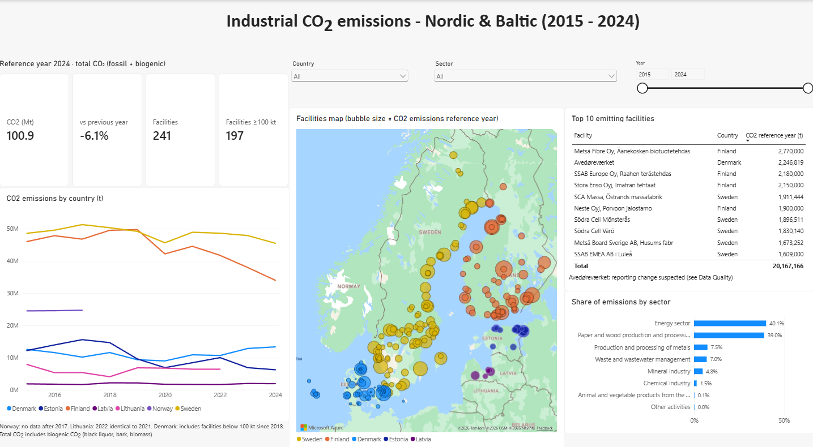

# Industrial CO₂ emissions – Nordic & Baltic countries (Power BI)

Which facilities and industrial sectors emit the most CO₂ in the Nordic and Baltic countries, and how is this changing? The report includes a focus on **mineral products (cement, lime, ceramics)**.



Other pages: [Mineral products](screenshots/mineral-products.png) · [Data quality](screenshots/data-quality.png) · [Full report (PDF)](report.pdf)

**Stack:** Power BI Desktop, Power Query (M), DAX · **Data:** EEA Industrial Reporting database v16 (Feb 2026), CC BY 4.0 · **Scope:** 7 countries, 2015–2024, 416 facilities

---

## Key findings (reference year 2024)

- **100.9 Mt of total CO₂** (fossil + biogenic) reported by **241 facilities**, of which **197 above the 100 kt reporting threshold**. **−6.1%** vs 2023.
- **Energy (40%) and pulp, paper & wood (39%) are almost level.** Six of the ten largest emitters are pulp and paper mills.
- **Biogenic CO₂ matters here.** In 2023, Swedish facilities reported 47.9 Mt of total CO₂, more than Sweden's entire national greenhouse-gas inventory (44.4 Mt CO₂e excluding LULUCF, all sectors). National inventories leave out biogenic CO₂ from black liquor, bark and biomass; this register includes it.
- **Mineral products: 4.7 Mt, 4.6% of the total** (the broader "Mineral industry" sector, which also includes mining and quarrying, is 4.8%). Cement & lime account for 98.5%, ceramics 1.5%. Two cement plants, Aalborg Portland (1.44 Mt) and Slite (1.39 Mt), emit 60% of the sector.
- **More than half of the long-term decline in mineral products is a coverage effect.** −47% between 2015 and 2024 with all countries, −29% on a constant scope (DK, EE, FI, LV, SE), because Norway and Lithuania drop out of the data. In 2024 alone: −14.5%.

## Report pages

| Page | Content |
|---|---|
| **Overview** | KPIs for the reference year, emissions by country (2015–2024), facility map, top 10 facilities, share by sector. Slicers for country, sector and years. |
| **Mineral products** | Cement & lime and ceramics: KPIs, trend, map, top 10, share by activity and share of total industrial CO₂. |
| **Data quality** | Reporting facilities per country and year, checks, exclusions, validation and limitations. |

KPIs, shares, map and top 10 use the **reference year** (the last year of the selection); line charts show the whole period.

## Data source

European Environment Agency (2026), *Industrial Reporting under the Industrial Emissions Directive 2010/75/EU and E-PRTR Regulation (EC) No 166/2006*, version 16.0 (February 2026).
DOI: [10.2909/657ac3cb-affa-4295-a4a9-27b4f539adab](https://doi.org/10.2909/657ac3cb-affa-4295-a4a9-27b4f539adab) · Licence: CC BY 4.0 · [European Industrial Emissions Portal](https://industry.eea.europa.eu/)

Files used: `F1_4_Air_Releases_Facilities` (facility level) and `F1_1_Air_Releases_National` (validation).

| Dimension | Selection |
|---|---|
| Countries | Denmark, Estonia, Finland, Latvia, Lithuania, Norway, Sweden (Iceland excluded: erratic, incomplete data) |
| Pollutant | "Carbon dioxide (CO2)" = total CO₂, **including biogenic CO₂**. The "CO₂ excluding biomass" variant is not used, to avoid double counting |
| Period | 2015–2024 |
| Unit | Tonnes (source in kg ÷ 1,000), displayed in Mt |
| Threshold | 100,000 t CO₂/year (E-PRTR). Denmark also reports smaller facilities since 2018 |

## Data preparation (Power Query)

1. **Base query** (not loaded): import, column types, filters (countries, pollutant, years), kg → t, facility names cleaned (*Clean*, *Trim*).
2. **Outlier exclusion**: a named step, `Excluded outliers`, removes three implausible values (see Data quality).
3. **Model tables**, built as *references* to Base so every correction is made in one place:
   - `Emissions` (fact): facility ID, year, emissions (t). Grain: one facility × one year.
   - `Sites` (dimension): one row per facility (latest record): name, city, country, sector, Annex I activity, validated map coordinates (`Lat_map`, `Lon_map`).
   - `Years` (dimension): 2015–2024.
4. **Activity labels**: mineral-industry Annex I codes 3(a)–3(g) mapped to readable names (cement & lime, ceramics, mineral fibres…).

## Data model

Star schema, single-direction many-to-one relationships, auto date/time disabled, measures in a dedicated `_Measures` table.

```
Sites (1) ──► (*) Emissions (*) ◄── (1) Years
```

## DAX highlights

```dax
Emissions (t) = SUM ( Emissions[Releases_t] )

-- Last year of the selection. ALLSELECTED keeps the slicers but ignores the row of a
-- table visual: the top 10 uses 2024, and Norway alone shows its own last year (2017)
Ref Year = CALCULATE ( MAX ( Emissions[reportingYear] ), ALLSELECTED ( Sites ) )

Emissions ref year =
VAR RefYear = [Ref Year]
RETURN CALCULATE ( [Emissions (t)], Years[Year] = RefYear )

YoY ref year =
VAR RefYear = [Ref Year]
VAR Curr = CALCULATE ( [Emissions (t)], Years[Year] = RefYear )
VAR Prev = CALCULATE ( [Emissions (t)], Years[Year] = RefYear - 1 )
RETURN DIVIDE ( Curr - Prev, Prev )

-- Facilities above the E-PRTR threshold (Denmark also reports smaller ones)
Sites ref year (100 kt+) =
VAR RefYear = [Ref Year]
RETURN CALCULATE ( [Site count], Years[Year] = RefYear, Emissions[Releases_t] >= 100000 )

-- Shares use the reference year, never the 2015–2024 sum
Sector share =
DIVIDE ( [Emissions ref year], CALCULATE ( [Emissions ref year], ALL ( Sites[EPRTR_SectorName] ) ) )

Share of total industrial CO2 =
DIVIDE (
    [Emissions ref year],
    CALCULATE ( [Emissions ref year], REMOVEFILTERS ( Sites[EPRTR_SectorName], Sites[Activity] ) )
)
```

Design choices:
- **One time frame per visual**: a share computed on the 2015–2024 sum gave 5.9% for mineral products instead of 4.6% in 2024.
- **No misleading changes**: year-on-year measures return blank, not −100%, when a year is missing.

## Data quality

| Check | Finding | Action |
|---|---|---|
| Coverage (facilities per country and year) | Norway: no data after 2017 (stopped reporting to the EU registry). Lithuania: no data for 2023–2024, and 2022 values are identical to 2021 for all 12 facilities. Denmark: since 2018 also reports facilities below 100 kt (44 of 66 in 2024) | Shown on every page; facilities counted with and without small sites; trends read per country |
| Iceland | Erratic, incomplete data (e.g. 870 t in 2021, despite large aluminium smelters) | Excluded |
| Implausible values | Estonia 2017 at ~25 Mt, close to the country's total GHG emissions. Cause: Gren Anne CHP (7.66 Mt vs ~260 kt usual) and Repo Vabrikud (1.48 Mt, only reported year). Akmenės cementas (Lithuania) 2018: 2.4 kt between 735 kt (2017) and 968 kt (2019) | Excluded in a named step |
| Coordinates | Fynsværket (Odense) with latitude 5.33 instead of ~55.4, plotted off Africa | Out-of-region coordinates excluded from the map, kept in totals |
| Text fields | Facility names with embedded line breaks from the source CSV | Cleaned (*Clean*, *Trim*) |
| Sector | 7 facilities with a blank sector, all small Danish sites | Documented |
| Classification | The "Mineral industry" sector includes Norwegian offshore oil & gas fields (activity 3(a)), ~30% of the sector in 2015–2017 | Excluded from the Mineral products page |
| Duplicates | No facility reported twice for the same year | — |

### Known issues, planned for v2

- **Step changes**: Avedøreværket goes from 162 kt (2022) to 2,105 kt (2023) and is now #2 in the top 10; Amagerværket shows a similar jump. Likely a change in how Danish biomass plants report.
- **Single-year gaps**: some facilities are missing one year between two reported years, which creates artificial dips in country trends.
- **Fossil vs biogenic**: a switch between total, fossil and biogenic CO₂, and a constant-scope view built into the model.

## Validation

| Check | Result |
|---|---|
| Import completeness: Sweden 2022, report vs EEA national table | 48,594,000 t vs 48,594,000 t (0% gap) |
| Plausibility: Sweden 2023, facilities vs national GHG inventory | 47.9 Mt total CO₂ vs 44.4 Mt CO₂e for the whole country: only possible because biogenic CO₂ is included here |

The national table is built from the same facility reports: the first check confirms the import is complete, not that the source is right. That is the role of the plausibility checks above.

## Limitations

- A facility register, not a national inventory: smaller plants, including most **glass and mineral-wool plants**, are not visible (except in Denmark).
- Total CO₂ includes **biogenic CO₂**, which national inventories report separately.
- Coverage breaks (Norway after 2017, Lithuania after 2022, Denmark 2018) make raw regional trends misleading: use a constant scope.
- No production volumes in the dataset, so no carbon-intensity analysis.

## Reproduce

1. Download the EEA dataset from the DOI above (user-friendly CSV, `F1_4_Air_Releases_Facilities`).
2. Open `nordic-industrial-emissions.pbix` in Power BI Desktop.
3. **Transform data → Data source settings → Change source**, point to your copy of the CSV, then **Refresh**.

## Repository content

```
nordic-baltic-industrial-co2-powerbi/
├── nordic-industrial-emissions.pbix   # Power BI report
├── report.pdf                         # PDF export of all pages
├── screenshots/
│   ├── overview.png
│   ├── mineral-products.png
│   └── data-quality.png
└── README.md
```

## Next step: applying the approach to plant data

The same approach (documented cleaning, plausibility checks, a clear star model, one time frame per visual) can be applied to a manufacturer's own energy and production data per plant and per line, to find where automation or AI would bring the largest energy and emission savings.

## References

- EEA (2025), [Total greenhouse gas emissions – Sweden](https://www.eea.europa.eu/en/europe-environment-2025/countries/sweden/total-greenhouse-gas-emissions), Europe's environment 2025.
